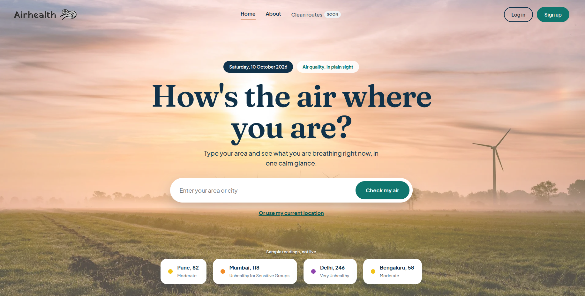
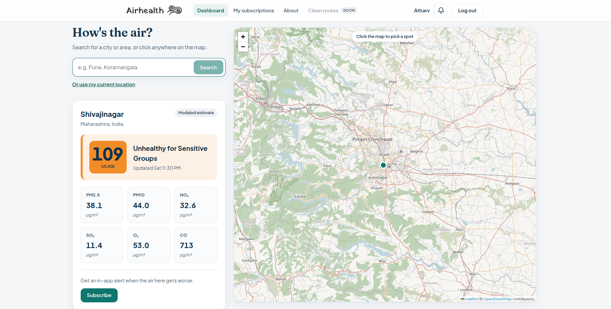
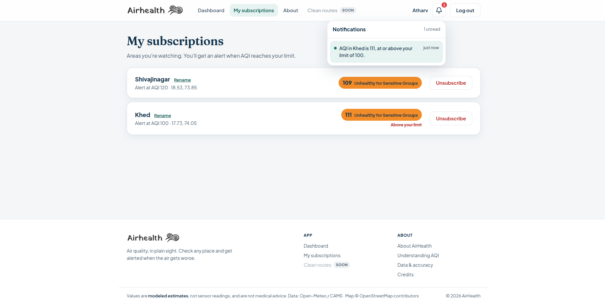

# Airhealth

Know the air before you step out. Airhealth lets you check the air quality of any place on a map
and subscribe to areas so you get notified when the air gets bad.

## Live Demo

https://airhealth-production.up.railway.app

## Screenshots





## Features

- **AQI map**: look up air quality for any area
- **Subscriptions**: subscribe to an area with an AQI threshold
- **In-app notifications**: get alerted when your threshold is crossed
- **Health info**: a page explaining how air quality affects health
- **Auth**: email + password login with JWT

## Tech Stack

| Layer    | Tech                                                             |
|----------|------------------------------------------------------------------|
| Backend  | Java 21, Spring Boot, Spring Data JPA, Spring Security, JJWT     |
| Database | PostgreSQL                                                       |
| Frontend | React + Vite (JavaScript), Leaflet                               |
| Data     | Open-Meteo Air Quality + Geocoding APIs, OpenStreetMap Nominatim |
| Hosting  | Railway (Docker)                                                 |

## How It Works

- Air quality data (US AQI and pollutants) is fetched from Open-Meteo and cached in memory. No air data is stored in the database.
- Subscription thresholds are checked when the frontend fetches notifications.
- The React build is served from the Spring Boot jar's static folder, so the whole app runs on a single origin.
- `SpaController` forwards client-side routes (`/about`, `/login`, `/app`, ...) to `index.html` so page refreshes work.
- The app is containerized with a multi-stage Dockerfile (Node build, Maven build, JRE runtime) and deployed on Railway.

## Running Locally

### Prerequisites

- Java 21
- Node.js 20.19+ (required by Vite 8)
- PostgreSQL

### Backend

1. Create a PostgreSQL database.
2. Set the [environment variables](#environment-variables) below.
3. Run:

```bash
cd backend
./mvnw spring-boot:run
```

The API runs on http://localhost:8080.

### Frontend

```bash
cd frontend
npm install
npm run dev
```

Open http://localhost:5173. The Vite dev server proxies `/api` and `/user` to the backend on port 8080.

## Run with Docker

```bash
docker build -t airhealth .
docker run -p 8080:8080 \
  -e DB_URL=<jdbc-url> \
  -e DB_USERNAME=<user> \
  -e POSTGRESQL_PASSWORD_AIRHEALTH=<password> \
  -e JWT_SECRET_AIRHEALTH=<secret> \
  airhealth
```

Then open http://localhost:8080.

## Environment Variables

| Variable                        | Description                                        | Default                                      |
|---------------------------------|----------------------------------------------------|----------------------------------------------|
| `DB_URL`                        | PostgreSQL JDBC URL                                | `jdbc:postgresql://localhost:5432/airhealth` |
| `DB_USERNAME`                   | Database username                                  | `airhealth`                                  |
| `POSTGRESQL_PASSWORD_AIRHEALTH` | Database password                                  | required                                     |
| `JWT_SECRET_AIRHEALTH`          | Secret used to sign JWTs                           | required                                     |
| `PORT`                          | HTTP port                                          | `8080`                                       |
| `NOMINATIM_USER_AGENT`          | User-Agent sent to Nominatim, per its usage policy | `AirHealth/0.1 (hackathon project)`          |

On Railway with the PostgreSQL plugin, `DB_URL` can be set to
`jdbc:postgresql://${{Postgres.PGHOST}}:${{Postgres.PGPORT}}/${{Postgres.PGDATABASE}}`.

## Tests

The backend has 98 tests (JUnit 5, Mockito, Spring Security Test):

- **Controller tests** (`@WebMvcTest`): request/response shape, bad-request cases, and auth rules for each endpoint
- **Service tests**: auth, JWT, users, subscriptions, notifications, air quality, and places, with repositories and clients mocked
- **Client tests**: the Open-Meteo geocoding and Nominatim reverse-geocoding clients
- **`contextLoads`**: starts the full application, so it needs a reachable database and the environment variables above

```bash
cd backend
./mvnw test
```

Frontend lint:

```bash
cd frontend
npm run lint
```

The Docker build skips tests (`-DskipTests`) because the build container has no database or secrets, so run them locally before deploying.

## Credits

- Air quality: [Open-Meteo Air Quality API](https://open-meteo.com/en/docs/air-quality-api) (CC BY 4.0). Contains modified Copernicus Atmosphere Monitoring Service information.
- Place search: [Open-Meteo Geocoding API](https://open-meteo.com/en/docs/geocoding-api), based on [GeoNames](https://www.geonames.org/) data.
- Map tiles and area names: © [OpenStreetMap contributors](https://www.openstreetmap.org/copyright) (ODbL), looked up with [Nominatim](https://nominatim.org/).
- Map display: [Leaflet](https://leafletjs.com).
- Fonts: [Fraunces](https://fonts.google.com/specimen/Fraunces) and [Plus Jakarta Sans](https://fonts.google.com/specimen/Plus+Jakarta+Sans) (SIL Open Font License), via [Fontsource](https://fontsource.org).
- Built with [Spring Boot](https://spring.io/projects/spring-boot), [JJWT](https://github.com/jwtk/jjwt), [React](https://react.dev), and [Vite](https://vite.dev).

## License

[MIT](LICENSE)

## Author

Atharv Chavan ([@Atharv3221](https://github.com/Atharv3221))
